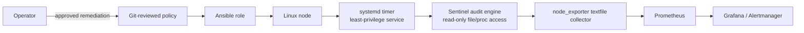

# SRE Node Sentinel

SRE Node Sentinel is a read-only Linux configuration auditor that exports policy
status to the Prometheus node-exporter textfile collector. It is packaged as a
small Python CLI and an Ansible role that installs a least-privilege systemd
timer. It is intended as a portfolio reference for operating Linux fleets, not
as a substitute for a formal compliance product or a security baseline.

## Why this project exists

Configuration drift is both an availability and security concern: an emergency
SSH change, an un-applied kernel setting, or a weakened systemd sandbox often
has no visible signal until an incident. Sentinel turns explicitly scoped,
reviewed controls into telemetry. It does **not** silently remediate a node;
configuration changes remain in version-controlled Ansible.

The project deliberately demonstrates:

- Linux configuration analysis without shell execution or destructive actions.
- Safe Ansible deployment, a dedicated account, restrictive file permissions,
  and hardened systemd service isolation.
- Prometheus-compatible metrics that can be alerted on and investigated.
- Offline filesystem auditing for image/AMI validation and deterministic tests.
- CI quality gates for Python, Ansible, dependency review, and CodeQL.

## Architecture



See the detailed [architecture notes](docs/architecture/overview.md).

## Repository layout

```
ansible/                 Deployment role and example playbook
docs/                    Architecture, operations, threat model, runbooks
examples/                Version-controlled policy examples
packaging/systemd/       Standalone unit examples
src/                     Python audit package
tests/                   Fast, filesystem-fixture unit tests
.github/workflows/       CI and scheduled security analysis
```

## Supported policy checks

| Type | Purpose | Example |
| --- | --- | --- |
| `sshd_directive` | Checks the first global setting in `sshd_config` | `PermitRootLogin: no` |
| `file_mode` | Checks Unix permission bits | `/etc/ssh/sshd_config: 0600` |
| `sysctl` | Checks live `/proc/sys` value, or offline config | `net.ipv4.conf.all.rp_filter: 1` |
| `mount_option` | Checks a live mount option from `mountinfo` | `/tmp` includes `noexec` |
| `systemd_setting` | Checks a unit INI key | `Service.NoNewPrivileges: true` |

An unsupported check or a setting that cannot be established is emitted as
`unknown`, not as a pass. This is intentional: unknown state should be
investigated rather than silently treated as compliant.

## Quick start

Requires Python 3.11+.

```bash
python3 -m venv .venv
.venv/bin/pip install -e '.[dev]'
.venv/bin/sre-node-sentinel --policy examples/baseline.yml --format json
.venv/bin/sre-node-sentinel --policy examples/baseline.yml --format prometheus
```

The command exits `1` if any evaluated check fails and `2` for input/runtime
errors. It writes metrics atomically when `--output` is supplied, so
node_exporter will not scrape a partially written file:

```bash
sre-node-sentinel --policy /etc/sre-node-sentinel/policy.yml \
  --format prometheus \
  --output /var/lib/node_exporter/textfile_collector/sre_node_sentinel.prom
```

### Offline image audit

Point `--root` at a mounted image or a test fixture. Live `/proc` checks will
prefer data under that root; mount checks are intentionally `unknown` when
`proc/self/mountinfo` is not available.

```bash
sre-node-sentinel --root /mnt/golden-image --policy examples/baseline.yml
```

## Ansible deployment

Install the role in your collection/playbook layout, tailor the policy, then
run the supplied playbook with privilege escalation:

```bash
ansible-playbook -i inventory/production ansible/site.yml --ask-become-pass
```

The target must already run node_exporter with the textfile collector pointing
at `/var/lib/node_exporter/textfile_collector` (or set
`sre_node_sentinel_textfile_directory`). Do not expose that directory over a
web server. Use a private package index and pin `sre_node_sentinel_package` to
an approved artifact in a real environment.

The service runs as a non-login system account and has no network address
families available except Unix sockets. It has read-only filesystem access
except for the collector directory. Review these restrictions before adding a
policy that needs files outside the default service namespace.

## Metrics and alerting

For each check, Sentinel exports a one-hot status series:

```text
sre_node_sentinel_check_status{policy="linux-sre-baseline",check="ssh-root-login-disabled",status="fail"} 1
sre_node_sentinel_failed_checks{policy="linux-sre-baseline"} 1
```

An example alert rule and dashboard queries are in
[monitoring.md](docs/monitoring.md). A useful initial alert is a failed high
severity control sustained for 15 minutes; alerting on all `unknown` values is
usually too noisy until you understand expected platform differences.

## Development and verification

```bash
python -m pip install -e '.[dev]'
ruff check .
pytest
ansible-lint ansible
ansible-playbook --syntax-check -i 'localhost,' -c local ansible/site.yml
```

The CI workflow executes these checks on pushes and pull requests. Dependency
review only runs on pull requests because it compares the proposed change with
its base revision. Dependabot maintains Python and Actions updates; CodeQL
runs on changes and weekly.

## Security boundaries

- The auditor does not execute policy content, invoke a shell, change files,
  or send data over the network.
- YAML uses safe loading and policy IDs are validated before they become metric
  labels.
- The Ansible role grants the service write access only to its metric file
  directory and uses atomic replace to avoid partial scrapes.
- Policy files may reveal hardening posture; keep their repository visibility
  appropriate for your organization.
- This project does not claim CIS, ISO 27001, SOC 2, or any other certification.
  Map individual checks to your approved control framework and test them on
  your target distributions.

See [threat model](docs/threat-model.md), [operations guide](docs/operations.md),
and the [runbooks](docs/runbooks/).

## License

Apache-2.0. Contributions should include tests and retain the read-only design
principle.
